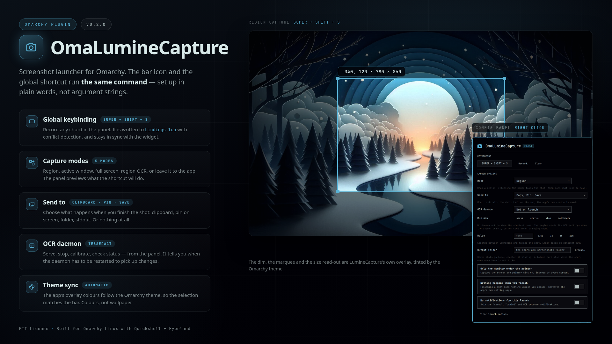

# OmaLumineCapture

An [Omarchy](https://omarchy.org) status bar plugin for [LumineCapture](https://github.com/Netflate/LumineCapture), the fast, lightweight Wayland screenshot tool.



## Installation

```bash
omarchy plugin add <this-repo-git-url> --enable
```

No manual setup required: clicking the bar icon will guide you through installing LumineCapture if it is not present.

## Features

- **Status bar icon** (camera). **Left-click** starts a capture; **right-click** opens the configuration panel.
- **Automatic dependency install**: if `lumine-capture-bin` (AUR) is not installed, a confirmation dialog offers to install it. If the AUR helper `yay` is missing, it is explained and installed first. Installation runs in a terminal with `--noconfirm`.
- **Global keybinding** (default `SUPER + SHIFT + S`, temporary default) with conflict checking against Hyprland bindings: on conflict, pick a suggested free chord or take over (the conflicting binding is disabled with a comment).
- **Right-click settings panel**: keybinding (record, clear, conflict resolution) and a control for every launch option below.
- **Theme sync**: LumineCapture's colors follow the Omarchy theme you have selected, and are rewritten when the theme changes.

## Launch options

Every option is one `lumine-capture` flag; this table is the mapping, the panel words its
controls in plain language. The panel warns about the combinations the app itself does not
act on.

| Control | Flag | Notes |
| --- | --- | --- |
| Mode | none, `-f`, `-w`, `-r`, `-r ocr` | No mode opens the editor. |
| Only the monitor under the pointer | `-m` | Nothing to do with `-w`: the app ignores it there. |
| Delay | `-d <SECONDS>` | `3` or `0.5`; empty leaves the flag out. |
| Send to | `-t <LETTERS>` | `c` copy, `p` pin, `s` save, `o` PNG to stdout, `r` primary selection. `r` only does something with `-r ocr`. Empty keeps the app's own `general.to`. |
| Nothing happens when you finish | `-t` bare | Overrides `general.to`: finishing without an explicit choice does nothing. |
| Output folder | `-o <DIR>` | Created if missing, and implies `s`. `~` is expanded so the global keybinding, which runs without a shell, gets the same path as the bar icon. |
| No notifications for this launch | `-n` | The app's `[notifications]` setting is left alone. |
| OCR daemon | `--ocr-daemon serve\|status\|stop\|calibrate` | On launch, plus **Run now** buttons that answer in the status line. `serve` outlives the panel. |
| Extra arguments | anything else | `-s`, `--config <path>`, ... passed through untouched. No control for it in the panel: put them in `settings.json` under `extraArgs`. |

The options are stored in the plugin's `settings.json`, and the global keybinding is
rewritten a moment after the last change, so the shortcut launches the same command the
bar icon does. Options the keybinding cannot carry (a comma in a path, characters a
Hyprland exec command does not survive) are reported in the panel: the bar icon still
passes them on.

## Theme

LumineCapture ships its own palette; Omarchy keeps the active theme's colors in
`~/.local/state/omarchy/current/theme/colors.toml`. The plugin maps those colors onto the
color keys of LumineCapture's `[theme]` section (`background`, `foreground`, `accent`,
`border`, `field`, `hover`, `caret`, `text_selection`, ...) and writes them into
`~/.config/LumineCapture/config.toml`, in place: every other line, comments included, is
left alone. Sizes, radii and font metrics belong to the app and are not touched. The
panel background takes the bar's own background alpha from the theme's `shell.toml`, so
the capture toolbar blends with the bar the way Omarchy's surfaces do.

Sync runs when the plugin loads and every few seconds afterwards, which is cheap: the
script exits as soon as the theme fingerprint is unchanged. For an instant sync on theme
change, install the theme hook:

```bash
omarchy hook install theme-set.d ~/Projects/omarchy-lumine-capture/scripts/theme-set-hook.sh
```

Apply it by hand any time with:

```bash
python3 ~/.config/omarchy/plugins/bramvanoploo.omarchy-lumine-capture/scripts/sync-theme.py --force
```

LumineCapture reads its config at startup, so a theme change lands on the next launch of
the app.

## Uninstall

```bash
omarchy plugin remove bramvanoploo.omarchy-lumine-capture
```

Then remove the `-- BEGIN bramvanoploo.omarchy-lumine-capture` block from `~/.config/hypr/bindings.lua` if a keybinding was applied, and the `# Colors below are synced from the Omarchy theme` lines that theme sync leaves in `~/.config/LumineCapture/config.toml`.

## Development

The argument builder and its reader are plain JS, so the mapping between options and
flags is testable without a shell:

```bash
node tests/launch-args.test.mjs
```

`preview.png` is rendered, not drawn by hand:

```bash
scripts/render-preview.sh
```

It photographs `docs/preview.html` with headless Chromium, tinted with the accent colours of the
active Omarchy theme and versioned from `manifest.json`. The two images in `docs/` are real UI:
refresh `shot-panel.png` after panel changes by opening the panel, running `grim`, and cropping the
settings card (`1044x1610+2406+52` at this display scale).

## License

MIT © Bram van Oploo
